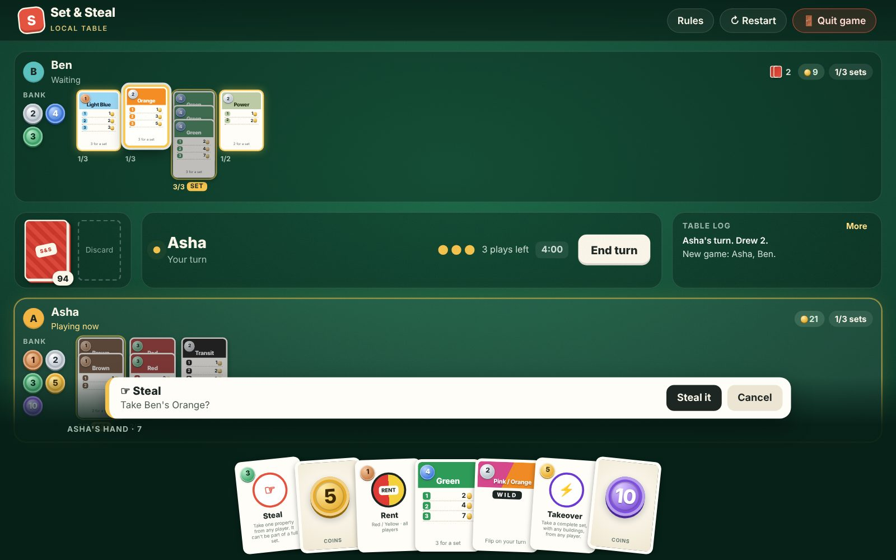
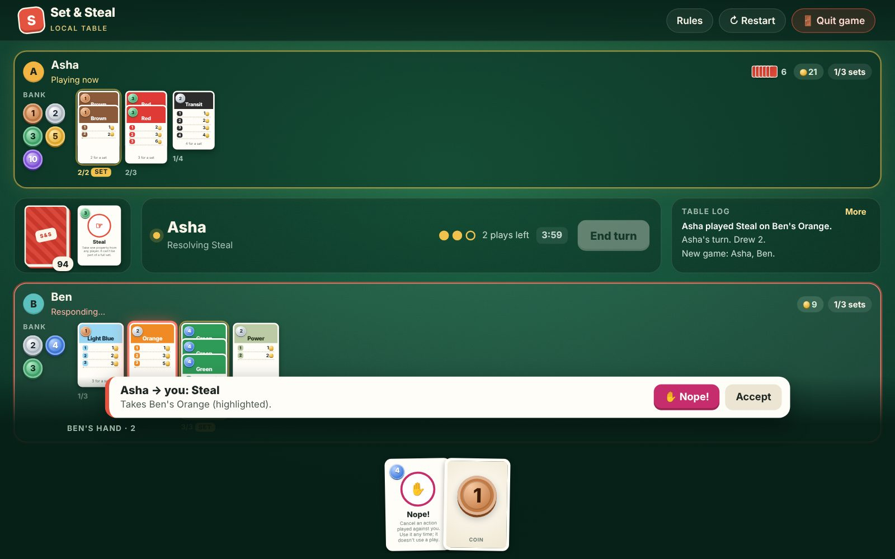
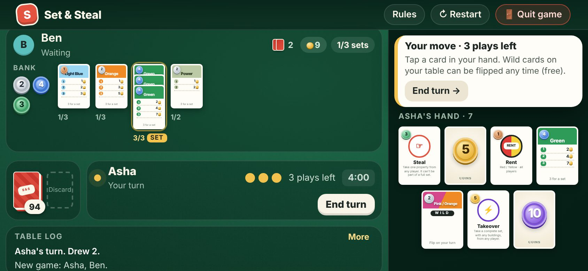
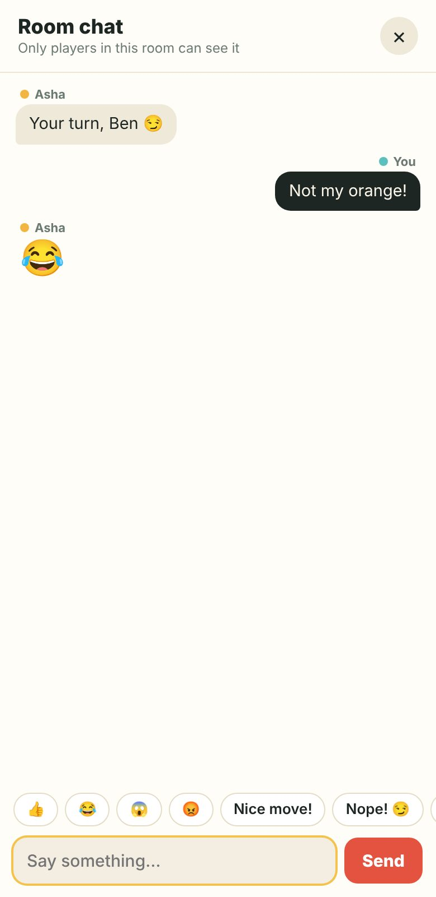

# Set & Steal

A quick card game for 2 to 5 players. Build three property sets, charge rent, and steal the cards you need with a tap on the table. Play on one device by passing it around, or online with friends in a private room.

**▶ Play:** https://set-and-steal.setandstealfree.workers.dev



## Features

- **106-card deck**: 20 coin cards, 28 properties, 11 property wilds, 13 rent cards and 34 action cards.
- **Tap the table to aim**: Steal, Swap, Takeover, rent, Collections, House and Tower all work by tapping cards, sets or players. Cards that can't be taken are dimmed.
- **Nope! chains**: the targeted player gets a response prompt. The attacker can answer back, you can reply again, and so on. A Nope! never uses one of your 3 plays.
- **Coins you can read at a glance**: banked money shows as round coins, one colour per value.
- **Paying debts**: pick coins, buildings or properties straight from your table. No change is given, and the Rainbow Wild can't be used to pay.
- **Turns end themselves** after your third play (you can still end early).
- **Instant online play**: moves and chat arrive the moment they happen.
- **Two ways to play**:
  - *Same device*: a "pass to…" curtain keeps each player's hand private.
  - *Online room*: share a 6-letter code. Each player plays and answers on their own phone or computer.
- **Room chat** with quick reactions, an unread badge and message previews.
- **Restart and Leave**: the host can deal a fresh game for the same room. Anyone can leave, and you can rejoin after a refresh.
- **Made for phones**: upright, your hand sits at the bottom; sideways, it moves to a side panel so the table keeps most of the screen.
- **Installable app**: add it to your home screen on Android, iPhone or desktop. It opens full screen and same-device games work offline. See [docs/install-app.md](docs/install-app.md).
- **Tested**: an automated browser test suite covers every card, online play, chat and the phone layouts, on both the Cloudflare and Node versions (`npm run test:worker`, `npm test`).

| Nope! response | Sideways on a phone | Chat on a phone |
| --- | --- | --- |
|  |  |  |

## How to play

Read **[docs/how-to-play.md](docs/how-to-play.md)**. It covers the rules and how to do each move on screen.

## Where it's hosted

Everything runs on **GitHub + Cloudflare**, free:

```
GitHub (this repo)  ── push to main ──►  Cloudflare Workers
                                          ├─ public/   game files (static, free and unlimited)
                                          └─ worker/   /api: one Durable Object per online room,
                                                       live updates over WebSockets
```

- Pushing to `main` redeploys the site automatically. See [deploy-cloudflare.md](docs/deploy-cloudflare.md).
- Moves and chat reach other players instantly over a live connection, and the site never goes to sleep.
- Same-device games run entirely in the browser.

The repository also still includes a small Node server (`server.js`) for running it anywhere else; see [self-hosting.md](docs/self-hosting.md).

## Documentation

| Guide | What's in it |
| --- | --- |
| [How to play](docs/how-to-play.md) | Rules, cards and on-screen controls |
| [Install as an app](docs/install-app.md) | Android, iPhone and desktop install, offline play, Play Store packaging |
| [Deploy to Cloudflare](docs/deploy-cloudflare.md) | How the live site is deployed, updated, previewed and paused |
| [Self-host (Node, Docker, Azure)](docs/self-hosting.md) | Run the site and API on your own server instead |
| [Architecture](docs/architecture.md) | How the code, game state and online sync work |
| [Developing](docs/developing.md) | Running locally, tests and making changes |
| [Handoff notes](docs/HANDOFF.md) | Everything a new developer (or a buyer) needs to take over |

## Quick start

With Node.js 20 or newer:

```bash
npm install
npm run dev              # the Cloudflare version locally: http://localhost:8787
npm start                # or the Node server with its built-in database: http://localhost:3000
```

## Project layout

```
wrangler.jsonc     Cloudflare configuration
worker/index.js    Cloudflare Worker: room API, chat and live updates (one Durable Object per room)
public/            The game (index.html, app.js, table.css, config.js) and app files (manifest, sw.js, icons)
server.js          Node server for self-hosting, with api/ (rooms, chat), lib/db.js and migrations/
tests/             Browser tests (npm test)
docs/              Documentation and screenshots
```
